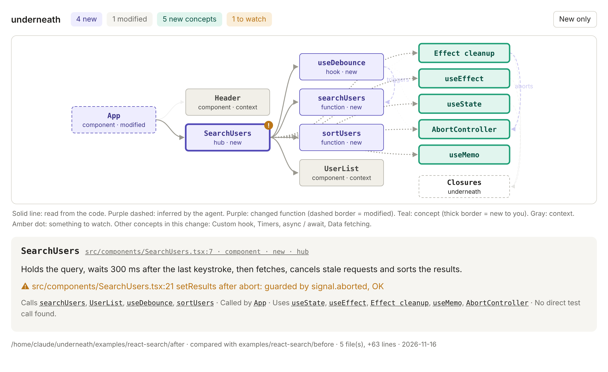

# underneath

**See what the AI just wrote, and what it rests on.**

Coding agents write more code than anyone can read. Day after day you accept diffs you only half understand, and the basics (closures, joins, the event loop) quietly fade.

`underneath` is an [Agent Skill](https://agentskills.io) that runs at the end of a coding task and gives you, in ten seconds:

1. **A 5-line card** in your terminal: what changed, the function everything flows through, the new concepts, the one thing to watch.
2. **A visual map** (`.underneath/latest.html`): the generated functions, how they call each other, the concepts each one uses, and the language fundamental underneath. Click anything for a two-line explanation.

```
underneath · 4 new · 1 modified · 5 new concepts · 1 to watch
  hub   App → SearchUsers → useDebounce, searchUsers, sortUsers
  new   Effect cleanup, useEffect, useState   ↓ closures
  ⚠     src/components/SearchUsers.tsx:21  setResults after abort: guarded by signal.aborted, OK
  map   .underneath/latest.html
```



## Why

In a randomized controlled trial, Anthropic found that developers learning a new library with AI assistance scored 17% lower on a comprehension quiz than those coding by hand, with the largest gap in debugging. Developers who asked conceptual questions while using AI kept most of their understanding ([Anthropic, 2026](https://www.anthropic.com/research/AI-assistance-coding-skills)).

`underneath` makes that conceptual step automatic, without quizzes and without slowing the agent down.

## What makes it different

- **The syntax tree decides, the model explains.** Functions, calls and concepts come from [tree-sitter](https://tree-sitter.github.io/), not from the model. The agent can only describe what is there. Notes that mention anything else are rejected.
- **Read from the code vs inferred.** Solid lines are extracted from the source. Dashed purple lines ("triggers", "aborts") are the agent's interpretation, and look like it.
- **One floor down.** Every concept points to the language fundamental it rests on: `useEffect` → closures, `useMemo` → reference equality, `LEFT JOIN` → three-valued logic. `/underneath deeper closures` shows a 10-line example.
- **Built for people who won't read.** 5 lines of text. At most 7 changed functions, 3 context functions and 5 concepts on the map. Everything else is one click away.
- **Likely bugs surface by themselves.** Some rules are marked `risk` (a mutable default argument in Python, a `WHERE` that undoes a `LEFT JOIN`). They are always drawn and the agent must check them.
- **It remembers what you know.** A local registry counts the concepts you have seen. New ones get a thick border; familiar ones fade out.
- **Local.** No network, no telemetry. `.underneath/` ignores itself in git.


## Install

Requires Python 3.10+.

```bash
git clone https://github.com/<you>/underneath
pip install -r underneath/requirements.txt
```

Then put the folder where your agent looks for skills:

| Agent | Location |
|---|---|
| Claude Code | `~/.claude/skills/underneath` (all projects) or `.claude/skills/underneath` (one project) |
| Codex, Cursor, Gemini CLI, Copilot and other Agent Skills clients | `.agents/skills/underneath` |

## Use

Work as usual. At the end of a task the agent runs the skill and shows the card. You can also ask:

- `/underneath`: map the uncommitted changes
- `/underneath since main`: map everything since `main`
- `/underneath deeper closures`: the fundamental, with a minimal example
- `/underneath known react.useState`: stop highlighting a concept you know

Or run the script yourself:

```bash
python3 scripts/underneath.py extract            # brief for the agent + .underneath/graph.json
python3 scripts/underneath.py render             # card + .underneath/latest.html
python3 scripts/underneath.py deeper three-valued-logic
```

### Try it without an agent

```bash
python3 scripts/underneath.py extract --before examples/sql-orders/before --after examples/sql-orders/after --out /tmp/demo
cp examples/sql-orders/notes.json /tmp/demo/
python3 scripts/underneath.py render --out /tmp/demo
open /tmp/demo/latest.html
```

## How it works

```
git diff ──▶ tree-sitter ──▶ graph.json ──▶ agent writes notes.json ──▶ render
             (functions,     (ranked, ≤15     (summaries, inferred       (card.md,
              calls, SQL      nodes, concepts   edges, watch items,        latest.html,
              references)     from stacks/)     one fundamental)           registry)
```

1. **Scope.** Changed files against `HEAD` (or `--base`), untracked files included.
2. **Extract.** Top-level functions, methods, components, hooks, SQL tables, views, indexes. Calls, JSX renders, decorators and SQL references become edges. Each symbol is new, modified or context.
3. **Rank.** Changed symbols are scored by status, connections, entry point (exported component, route, view) and size. The best-connected one is the hub. Callers outside the diff become context; test files become "tested by N tests" instead of nodes.
4. **Concepts.** Rules from `references/stacks/*.md` run on each symbol. Risk rules first, then one concept per function, then the rest.
5. **Explain.** The agent reads a compact brief and writes `notes.json` (format in `references/card-format.md`).
6. **Render.** Notes are checked against the graph, then the card, the map and the registry are written.

Extraction takes well under a second on mid-size repositories.

## Add a stack

A stack is one Markdown file in `references/stacks/`. Each concept is a section:

```markdown
## useEffect
- id: react.useEffect
- detect: call useEffect
- fundamental: closures
- what: Runs a side effect after render, and again whenever a dependency changes.
- pitfalls: A missing dependency leaves a stale value; setting state that is also a dependency causes a loop.
- relates: react.useState, react.effectCleanup
```

`detect` accepts `call NAME` (from the syntax tree), `regex PATTERN` (on the function's source, comments removed) and `name PATTERN` (on the function's name). Add `requires: <id>` for concepts that only make sense together, and `risk: yes` when a match is itself a likely bug.

Point `fundamental` to an entry in `references/fundamentals.md`, or add one there with a short, runnable example.

Then add a `before/` and `after/` folder under `examples/`, a `notes.json`, and a test in `tests/test_examples.py`. Run `python3 tests/test_examples.py`.

Stacks we would love to see: Vue, Svelte, Next.js server components, Django ORM, FastAPI, Go, Rust, Kotlin, Flutter.

## Limits (v0.1)

- Calls are resolved by name, with same-class, same-file and import hints. Dynamic calls and same-named functions in unrelated files can be missed or mislinked.
- Only top-level functions and methods are nodes. Nested functions are folded into their parent.
- SQL inside Python or JavaScript strings is not parsed.
- Concept rules are pattern-based. They can miss unusual spellings and, rarely, match in the wrong place.
- The map is regenerated each time. There is no history yet.

## Roadmap

- **v0.2**: `/underneath map` (the whole project's concept skeleton), `/underneath gaps` (concepts in your code you never marked as known).
- **v0.3**: Claude Code plugin with a `Stop` hook, so the card appears by itself at the end of a task. Optional reading of a [Graphify](https://github.com/Graphify-Labs/graphify) `graph.json` for callers outside the repo scan.
- **v0.4**: public evaluation set (diffs + expected concepts), more stacks.
- **v1.0**: team mode, with a shared project registry as living onboarding documentation.

## Credits

The split between extracted and inferred edges, and the idea of a "god node" everything flows through, come from [Graphify](https://github.com/Graphify-Labs/graphify). Graphify maps a codebase for the agent; `underneath` maps a change for the human.

## License

MIT
