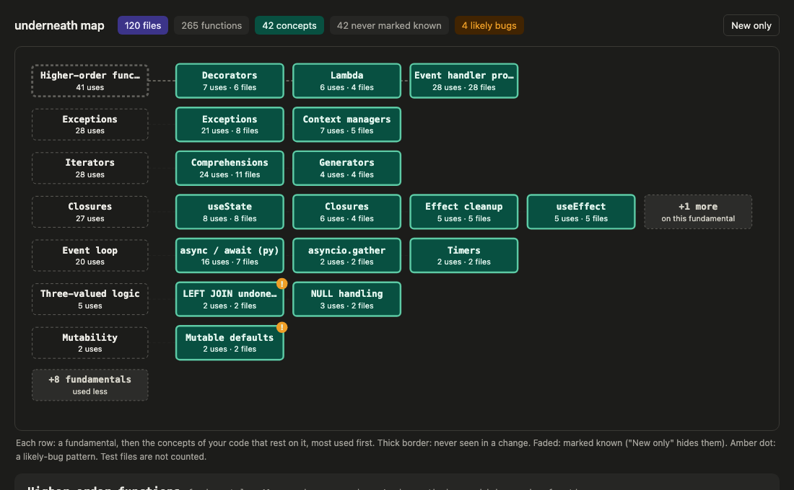

# underneath

[](https://github.com/touredri/underneath/actions/workflows/ci.yml)

**See what the AI just wrote, and what it rests on.**

Coding agents write more code than anyone can read. Day after day you accept diffs you only half understand, and the basics (closures, joins, the event loop) quietly fade.

`underneath` is an [Agent Skill](https://agentskills.io) and a Claude Code plugin that runs at the end of a coding task and gives you, in ten seconds:

1. **A 5-line card** in your terminal: what changed, the function everything flows through, the new concepts, the one thing to watch.
2. **A visual map** (`.underneath/latest.html`): the generated functions, how they call each other, the concepts each one uses, and the language fundamental underneath. Click anything for a two-line explanation.

```
underneath · 4 new · 1 modified · 5 new concepts · 1 to watch
  hub   App → SearchUsers → useDebounce, searchUsers, sortUsers
  new   Effect cleanup, useEffect, useState   ↓ closures
  ⚠     src/components/SearchUsers.tsx:21  setResults after abort: guarded by signal.aborted, OK
  map   .underneath/latest.html
```


## Why

In a randomized controlled trial, Anthropic found that developers learning a new library with AI assistance scored 17% lower on a comprehension quiz than those coding by hand, with the largest gap in debugging. Developers who asked conceptual questions while using AI kept most of their understanding ([Anthropic, 2026](https://www.anthropic.com/research/AI-assistance-coding-skills)).

`underneath` makes that conceptual step automatic, without quizzes and without slowing the agent down.

## What makes it different

- **The syntax tree decides, the model explains.** Functions, calls and concepts come from [tree-sitter](https://tree-sitter.github.io/), not from the model. The agent can only describe what is there. Notes that mention anything else are rejected.
- **Read from the code vs inferred.** Solid lines are extracted from the source. Dashed purple lines ("triggers", "aborts") are the agent's interpretation, and look like it.
- **One floor down.** Every concept points to the language fundamental it rests on: `useEffect` → closures, `useMemo` → reference equality, `LEFT JOIN` → three-valued logic. `/underneath deeper closures` shows a 10-line example.
- **Built for people who won't read.** 5 lines of text. At most 7 changed functions, 3 context functions and 5 concepts on the map. Everything else is one click away.
- **Honest about what changed.** Code moved to another file, or pulled out of a big function, is marked *moved*, not new. Tests are not drawn: they become "tested by N" on the functions they call.
- **Likely bugs surface by themselves.** Some rules are marked `risk` (a mutable default argument in Python, a `WHERE` that undoes a `LEFT JOIN`). They are always drawn and the agent must check them.
- **It remembers what you know.** A local registry counts the concepts you have seen. New ones get a thick border; familiar ones fade out. `/underneath gaps` lists the ones you never marked as known.
- **Measured.** An evaluation set of 18 diffs checks that no concept is invented and no false link is drawn (see [Evaluation](#evaluation)).
- **Local.** No network, no telemetry. `.underneath/` ignores itself in git.


## Install

Requires Python 3.10+ and git. Install the parser once, in a virtualenv the script finds by itself (macOS and recent Linux refuse `pip install` into the system Python):

```bash
python3 -m venv ~/.underneath/venv
~/.underneath/venv/bin/pip install tree-sitter tree-sitter-language-pack
```

### Claude Code (plugin, with the automatic card)

In Claude Code:

```
/plugin marketplace add touredri/underneath
/plugin install underneath@underneath
```

The plugin adds the skill and a `Stop` hook: when a turn changed code, the agent shows the card before it finishes. The hook asks once per change, never loops, and stays quiet when nothing was edited or the change is tiny. To turn it off for a project, put `{"stop_hook": false}` in `.underneath/config.json`.

### Any agent (skill only)

```bash
git clone https://github.com/touredri/underneath
```

Then put the folder where your agent looks for skills:

| Agent | Location |
|---|---|
| Claude Code | `~/.claude/skills/underneath` (all projects) or `.claude/skills/underneath` (one project) |
| Codex, Cursor, Gemini CLI, Copilot and other Agent Skills clients | `.agents/skills/underneath` |

A `.venv` inside the cloned folder works too.

## Use

Work as usual. At the end of a task the agent runs the skill and shows the card. You can also ask:

- `/underneath`: map the uncommitted changes
- `/underneath since main`: map everything since `main`
- `/underneath map`: the whole project's concept skeleton
- `/underneath gaps`: concepts in your code you never marked as known
- `/underneath deeper closures`: the fundamental, with a minimal example
- `/underneath known react.useState`: stop highlighting a concept you know

### The project map

`/underneath map` reads every file once and groups the concepts of your code by the fundamental they rest on: one row per fundamental, its concepts most used first, each with its use count and main files. Here it is on this repository:

```
underneath map · 120 files · 265 functions · 42 concepts on 15 fundamentals
  top   higher-order functions 41 · exceptions 28 · iterators 28
  ⚠     Mutable defaults ×2 · first at examples/project-map/api/app/services.py:4 (+1 other)
  gaps  42 never marked known · /underneath gaps
  map   .underneath/map.html
```



`/underneath gaps` turns it into a reading list:

```
underneath gaps · 42 of 42 concepts in your code never marked known, most used first
  Comprehensions      24×  /underneath deeper py.comprehension
  Exceptions          21×  /underneath deeper py.exceptions
  async / await (py)  16×  /underneath deeper py.asyncAwait
  useState             8×  /underneath deeper react.useState
```

### Run it yourself

```bash
python3 scripts/underneath.py extract            # brief for the agent + .underneath/graph.json
python3 scripts/underneath.py render             # card + .underneath/latest.html
python3 scripts/underneath.py map                # card + .underneath/map.html
python3 scripts/underneath.py gaps
python3 scripts/underneath.py deeper three-valued-logic
```

### Try it without an agent

```bash
python3 scripts/underneath.py extract --before examples/sql-orders/before --after examples/sql-orders/after --out /tmp/demo
cp examples/sql-orders/notes.json /tmp/demo/
python3 scripts/underneath.py render --out /tmp/demo
open /tmp/demo/latest.html
```

### Configuration

`.underneath/config.json` is optional:

```json
{ "language": "fr", "stop_hook": false, "limits": { "changed": 7, "context": 3, "concepts": 5, "min_lines": 8 } }
```

`language` sets the language of the agent's notes, `stop_hook` turns the plugin's hook off, `limits` changes the map budgets.

## How it works

```
git diff ──▶ tree-sitter ──▶ graph.json ──▶ agent writes notes.json ──▶ render
             (functions,     (ranked, ≤10     (summaries, inferred       (card.md,
              calls, SQL      nodes, concepts   edges, watch items,        latest.html,
              references)     from stacks/)     one fundamental)           registry)
```

1. **Scope.** Changed files against `HEAD` (or `--base`), untracked files included.
2. **Extract.** Top-level functions, methods, components, hooks, SQL tables, views, indexes, in the changed files and in the files that can connect to them (found with `git grep`, so a large repository is not parsed whole). Calls, JSX renders, decorators and SQL references become edges. Each symbol is new, modified, moved or context.
3. **Rank.** Changed symbols are scored by status, connections, entry point (exported component, route, view) and size. The best-connected one is the hub. Callers outside the diff become context; test files become "tested by N tests" instead of nodes.
4. **Concepts.** Rules from `references/stacks/*.md` run on each symbol (comments and Python strings removed). Risk rules first, then one concept per function, then the rest.
5. **Explain.** The agent reads a compact brief and writes `notes.json` (format in `references/card-format.md`).
6. **Render.** Notes are checked against the graph, then the card, the map and the registry are written.

On a 2,000-file React + Python repository, a diff takes 1.5 to 4 seconds; the project map takes 5 seconds the first time and under one second after that.

## Evaluation

`evals/` holds diffs with the concepts and links a human expects. `python3 evals/run.py` reports:

- **concept precision**: a detected concept that is neither expected nor allowed is *invented*. The target is zero, and CI fails otherwise;
- **concept recall**: expected concepts that were found;
- **edge recall** and **false links**: expected calls found, and edges that should not be there;
- **wrong context**: an unchanged function drawn when it should not be (a utility used everywhere), or missing when it should be (a caller).

| | v0.1 | v0.2.1 |
|---|---|---|
| Concept precision | 91.2% (6 invented) | 100% (0 invented) |
| Concept recall | 100% | 100% |
| Edge recall | 100% | 100% |
| False links | 2 | 0 |

18 cases: the examples, a few realistic changes per stack, and traps (a docstring that says "await", `IS NOT NULL`, a variable named `signal`, `dict.get` next to a class with a `get` method, `cn` and `Button` used in every page). Add a case with a `before/`, an `after/` and an `expected.json`; `python3 evals/run.py --show <case>` prints what the tool sees.

## Add a stack

A stack is one Markdown file in `references/stacks/`. Each concept is a section:

```markdown
## useEffect
- id: react.useEffect
- detect: call useEffect
- fundamental: closures
- what: Runs a side effect after render, and again whenever a dependency changes.
- pitfalls: A missing dependency leaves a stale value; setting state that is also a dependency causes a loop.
- relates: react.useState, react.effectCleanup
```

`detect` accepts `call NAME` (from the syntax tree), `regex PATTERN` (on the function's source, comments and Python strings removed) and `name PATTERN` (on the function's name). Add `requires: <id>` for concepts that only make sense together, `risk: yes` when a match is itself a likely bug, and `minor: yes` for basics that are everywhere (they are drawn only when nothing more telling is left).

Point `fundamental` to an entry in `references/fundamentals.md`, or add one there with a short, runnable example.

Then add a case under `evals/cases/` (or an example under `examples/` with a test in `tests/test_examples.py`), including one that should *not* match. Run `python3 tests/test_examples.py` and `python3 evals/run.py`.

Stacks we would love to see: Vue, Svelte, Next.js server components, Django ORM, FastAPI, Go, Rust, Kotlin, Flutter.

## Limits (v0.2)

- Calls are resolved by name, with same-class, same-file and import hints. Dynamic calls and same-named functions in unrelated files can be missed. Methods of built-in types (`get`, `push`, `map`…) called on another object are never linked, even when the object really is one of yours.
- Only top-level functions and methods are nodes. Nested functions are folded into their parent; classes themselves are not nodes, so a decorator on a class is not counted.
- SQL inside Python or JavaScript strings is not parsed.
- Concept rules are pattern-based. The evaluation set keeps them honest, but it is small.
- The map is regenerated each time. There is no history yet.

## Roadmap

- **v0.3**: optional reading of a [Graphify](https://github.com/Graphify-Labs/graphify) `graph.json` for callers outside the repo scan, classes as nodes, a larger public evaluation set.
- **v0.4**: more stacks (Vue, Django, Go).
- **v1.0**: team mode, with a shared project registry as living onboarding documentation.

## Credits

The split between extracted and inferred edges, and the idea of a "god node" everything flows through, come from [Graphify](https://github.com/Graphify-Labs/graphify). Graphify maps a codebase for the agent; `underneath` maps a change for the human.

## License

MIT
